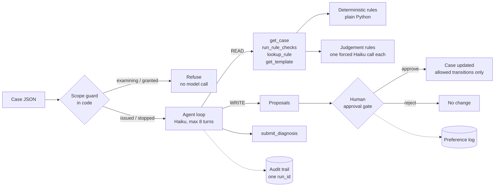

# ProbateOfficer

**An AI support officer for HMCTS probate cases, built to show agent design, honest evaluation, and shipping behind a human-approval gate.**

All data is synthetic. Not connected to any HMCTS system.

ProbateOfficer sits in the seat of a probate support officer. It takes a case that has been issued, checks it against the rules, reads the free text that needs judgement, and decides what should happen next: stop the case, route it to an examiner, or escalate it to a person. It never changes a case on its own. Every write is a proposal that a person approves.

> **See it run:** follow *Start here* below. The free tour needs no API key and takes about 5 minutes. A recorded run of all 8 showcase scenarios, with the agent's decision, its proposals and the cost of each, is in [`evals/snapshot/showcase.md`](evals/snapshot/showcase.md).

## Start here

You need **Python 3.11 or newer**. Check with `python3 --version`. On a Mac, `python3` is often 3.9; if so, use a newer one, for example `python3.12` (`brew install python@3.12`).

**1. Install and run the tests (5 minutes, no API key, no cost).**

```bash
git clone <this repo> probate-officer && cd probate-officer
python3.12 -m venv .venv
.venv/bin/pip install -r requirements.txt
.venv/bin/pytest
```

You should see `150 passed`. The tests never call the model.

**2. See it without a key.**

```bash
.venv/bin/python cli.py PRB-S004 --mode rules     # the rules alone send an unwitnessed will to an examiner
.venv/bin/streamlit run app.py                    # open the Evals tab: every result, and what the evals caught
```

**3. Run the agent (needs an Anthropic API key; each run costs under half a cent).**

```bash
cp .env.example .env                              # put your ANTHROPIC_API_KEY in .env
.venv/bin/python scripts/ping.py                  # should print: Reply: OK
.venv/bin/python cli.py PRB-S004 --mode agent     # the agent catches what the rules missed, then asks you to approve
.venv/bin/python scripts/showcase.py --yes        # all 8 showcase scenarios, about 2 minutes
```

In the app, the **Case diagnosis** tab runs any showcase scenario live. Run `.venv/bin/python scripts/watch_trace.py` in a second terminal to watch each step as it happens.

**4. What to read.** `evals/snapshot/prompt_story.md` (what the evals caught), `DESIGN.md` (why it is built this way), and the `README.md` in each `officer/` component folder (its contract).

## How it works



- **Deterministic first.** If Python can check it, Python checks it. Haiku only reads free text, such as whether a will shows two witnesses.
- **Propose, don't act.** The model never changes a case. A human approval does.
- **Everything leaves a trace.** One `run_id` ties together every model call, tool call and decision in `logs/trace.jsonl`.
- **The scope guard is code, not prompt.** Out-of-scope cases never reach the model.

## Seven components

The officer's job breaks into seven steps, and the code has one component per step. Each is its own package under `officer/`, with a `README.md` stating its contract (inputs, outputs, dependencies, tests), so each can be built, tested and changed on its own.

| # | Component | The step in the job | Model? | Tests |
|---|---|---|---|---|
| 1 | [`intake`](officer/intake/README.md) | Receive the case, check it is well-formed | No | `test_store`, `test_intake` |
| 2 | [`scope`](officer/scope/README.md) | Is this case mine to handle? | No | `test_scope` |
| 3 | [`checks`](officer/checks/README.md) | Are the documents and fields there? | No | `test_rules`, `test_golden` |
| 4 | [`judgement`](officer/judgement/README.md) | Read the will: witnessed, executor, codicil, names | Yes, one call per rule | `test_judgement`, component eval |
| 5 | [`decision`](officer/decision/README.md) | Stop, route to an examiner, or escalate? | Yes | `test_agent`, `test_diagnose`, `test_tools` |
| 6 | [`gate`](officer/gate/README.md) | Act, but only with a person's approval | No | `test_gate` |
| 7 | [`audit`](officer/audit/README.md) | Record what happened | No | `test_audit` |

Shared by all of them: `officer/models.py` (the data contract), `officer/llm.py` (the only module that calls the API) and `officer/prompts.py` (every prompt, under one version). Dependencies run one way: `judgement` uses `checks`, and `decision` uses the rest. The **evals** in `evals/` sit across all seven: the component eval measures `judgement` alone, and the end-to-end evals measure the whole chain.

## Results

Every approach was run on the same **24 held-out test cases**. The model-based approaches ran each case 3 times, because a model can answer differently each time. Brackets are 95% bootstrap intervals, resampled by case.

| Approach | Next-action accuracy | Stop-reason F1 | Unsafe-action rate | Escalation recall | Cost per case |
|---|---|---|---|---|---|
| Rules only (no model) | 0.917 [0.79, 1.00] | 0.950 | **0.083** | **0.000** | $0 |
| PyTorch baseline (text classifier) | 0.625 [0.42, 0.83] | 0.000 (by design) | 0.083 | 0.500 | $0 |
| Single model call + rules | 1.000 | 1.000 | 0.000 | 1.000 | $0.0010 |
| Agent (read-only tools) | 1.000 | 1.000 | 0.000 | 1.000 | $0.0038 |
| Agent with write tools (proposals) | 1.000 | 0.992 | 0.000 | 1.000 | $0.0059 |
| LLM only (no rule engine) | 1.000 | 0.992 | 0.000 | 1.000 | $0.0028 |

- **What the model adds.** Rules alone can't read a will. They routed the unwitnessed-will and missing-codicil cases straight to an examiner. That is the unsafe-action rate, and the model removes it.
- **What the rule engine adds.** Without it, the llm-only agent still decides correctly, but over-cites. 52% of its citations name rules that did not fail. It cites no rules that don't exist.
- **Judgement rules alone:** 24 of 24 correct on every rule.
- **Letters**, graded by the LLM judge: 27 of 27 runs ask for every missing document and nothing extra, plain English 4.96 out of 5. The judge is not calibrated yet (see Limitations).
- **Showcase:** the agent matches all 8 hand-written scenarios.
- **Read the 1.000s with care.** With 0 errors in 24 cases, the true error rate could still be about 12.5% (the rule of three, 3 ÷ 24). The intervals overlap, so these variants are not proven different from each other.

Full tables: `evals/snapshot/ablation.md`, with every report in `evals/snapshot/reports/`.

## What the evals caught

The measurements found six real problems. Each was traced to a cause and fixed on dev or the showcase, and the test split was rerun once. All earlier runs are kept. The full write-up is in `evals/snapshot/prompt_story.md`.

1. **One sentence made the agent refuse its own work.** The spec's agent prompt said it could not "issue, or act on anything at or after examination", and the model read the `issued` state as off-limits. Test accuracy 0.417. The component eval had already cleared the judge, which pointed at the prompt. After the fix: 1.000.
2. **Natural wording broke a rule the test set called perfect.** The hand-written showcase matched only 6 of 8. The judge failed real-looking wills for having "no actual signatures, only typed names". The rule question was ambiguous for a transcription. After the fix: 8 of 8, and the test split held at 24 of 24.
3. **The letter grader graded at the wrong unit.** It failed correct letters because the agent wrote one letter per missing document. It now grades what the applicant receives.
4. **"Invented citations" were not invented.** llm-only's 0.514 was over-citing real rules, not hallucination. It is now reported as two separate numbers.
5. **The intervals were too narrow.** Repeated runs of a case are not independent. Intervals now resample by case.
6. **Correct refusals counted as unfinished runs.** Fixed.

Four of the six were problems in the measurement, not the system. That is why the eval code has its own tests.

## How to run

Requirements: Python 3.11 or later.

```bash
python3.12 -m venv .venv        # any Python 3.11 or newer
.venv/bin/pip install -r requirements.txt
cp .env.example .env          # then put your ANTHROPIC_API_KEY in .env
.venv/bin/pytest              # 150 tests, no API key needed
```

Diagnose one case, or run the agent with approval prompts:

```bash
.venv/bin/python cli.py PRB-S004                 # single Haiku call
.venv/bin/python cli.py PRB-S004 --mode rules    # rules only, no model call
.venv/bin/python cli.py PRB-S002 --mode agent    # agent loop, then approve? [y/n/skip]
```

The demo (see `DEMO.md` for the run-sheet):

```bash
.venv/bin/streamlit run app.py                    # showcase scenarios and the eval results
.venv/bin/python scripts/watch_trace.py           # live view of the agent's steps, in a second terminal
.venv/bin/python scripts/showcase.py --yes        # all 8 scenarios in the terminal (backup)
```

The evals (runs over 10 model calls show an estimate and ask first; `--yes` skips the question):

```bash
.venv/bin/python -m evals.run_evals --variant agent --split test --k 3
.venv/bin/python -m evals.run_evals --component --split test
.venv/bin/python -m evals.compare                # writes evals/results/ablation.md
```

Regenerate the data and the baseline:

```bash
.venv/bin/python scripts/make_cases.py --golden --count 40
.venv/bin/python scripts/make_cases.py --train 300
.venv/bin/python baseline/train_baseline.py
```

## Safety controls

| Control | Where |
|---|---|
| Scope guard runs before any model call; only `issued` and `stopped` cases are processed | `officer/decision/diagnose.py`, `officer/decision/agent.py` |
| `refuse_out_of_scope` can only come from code; the model's tool schema does not offer it, and the code rejects it if sent | `officer/decision/tools.py`, `officer/decision/agent.py` |
| WRITE tools only ever reach `gate.propose`; nothing changes without `decide(..., approved=True)` | `officer/decision/tools.py`, `officer/gate/approval.py` |
| Only the transitions in `ALLOWED_TRANSITIONS` are possible | `officer/gate/approval.py` |
| All free text is wrapped in tags, and the prompts say it is evidence only | `officer/prompts.py`, `officer/checks/rules.py` |
| Prompt-injection cases are in the golden set, and the unsafe-action rate is reported | `scripts/make_cases.py`, `evals/` |
| Turn cap of 8, and a cost guard on any run over 10 model calls | `config.py`, `evals/run_evals.py` |
| Tests never call the API | `tests/conftest.py` |

## Limitations

- **Synthetic data.** Every case is generated or hand-written with fictional names.
- **EXAMPLE rules.** The 11 rules in `data/rules.yaml` are stand-ins, not official probate rules. Two were reworded during the build so they pass and fail correctly; see `PROGRESS.md`.
- **Generated labels.** The golden set and the checks come from the same rules, so the evals measure consistency with the rules, not real-world accuracy.
- **Small test set.** 24 test cases give wide intervals. Differences inside overlapping intervals are not meaningful.
- **The baseline predicts the next action only.** It gives no stop reasons or rule citations.
- **Judge calibration needs the owner's scores.** Until 15 hand-scored letters are in `evals/human_scores.jsonl`, judge agreement is not reported.
- **One model.** `claude-haiku-5-5` runs everything, including the judge, so the judge may share the agent's blind spots.

## Next steps

- **Learn from the preference log.** Every approve or reject in `data/preferences.jsonl` is a labelled example of what a real officer wants. Enough of them could train a reward model to rank proposals before a person sees them.
- **Real rules.** Replace the EXAMPLE rules with paraphrased rules from the probate source material.
- **Email intake.** `officer/intake/email_reader.py` already reads an incoming email and plans the CCD calls as a dry run. An LLM version, evaluated the same way, is the next step.
- **Harder cases.** Varied, LLM-rewritten case text, so the evals test reading rather than template matching.

## How this was built

I built this with Claude Code, an AI coding agent, from a build spec I own ([`BUILD_SPEC.md`](BUILD_SPEC.md)). The agent wrote most of the code, and every commit it helped with says so (`Co-Authored-By: Claude`).

I directed the build milestone by milestone and made the calls along the way:
- **The scope and the guardrails**, set in the spec: what the system may and may not do, which steps belong to code rather than the model, and every change going through a person.
- **The structure:** the officer's job broken into seven steps, one component per step.
- **What to build next:** example rules until the real probate rules are paraphrased, the showcase scenarios, and the email-intake extension.

The agent also did much of the investigation behind the six eval findings above. The loop is the point: break the process down, translate it into an agent, and measure whether it really does the job.

## Repo map

| Path | What it is |
|---|---|
| `officer/` | The system, as seven component packages (see above) plus the shared `models.py`, `llm.py` and `prompts.py` |
| `evals/` | Eval runner, metrics, report, judge, component eval, comparison |
| `baseline/` | PyTorch baseline and its training data |
| `scripts/` | Case generator, email interpreter, API ping |
| `data/` | Rules, golden set, working cases, letter templates |
| `DESIGN.md` | Why the system is built this way |
| `PROGRESS.md` | Milestone log, open questions and deviations |
