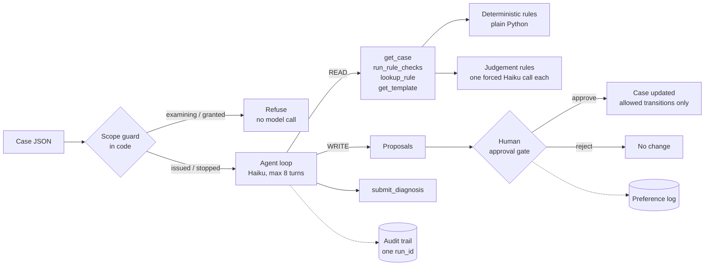

# ProbateOfficer

**An AI support officer for HMCTS probate cases, built to show agent design, honest evaluation, and shipping behind a human-approval gate.**

All data is synthetic. Not connected to any HMCTS system.

ProbateOfficer sits in the seat of a probate support officer. It takes a case that has been issued, checks it against the rules, reads the free text that needs judgement, and decides what should happen next: stop the case, route it to an examiner, or escalate it to a person. It never changes a case on its own. Every write is a proposal that a person approves.

> Demo: a short screen recording of the Streamlit app goes here (`docs/demo.gif`).

## How it works



- **Deterministic first.** If Python can check it, Python checks it. Haiku only reads free text, such as whether a will shows two witnesses.
- **Propose, don't act.** The model never changes a case. A human approval does.
- **Everything leaves a trace.** One `run_id` ties together every model call, tool call and decision in `logs/trace.jsonl`.
- **The scope guard is code, not prompt.** Out-of-scope cases never reach the model.

## Results

<!-- RESULTS -->

## What the evals caught

The first agent prompt was copied word for word from the spec. On the test split it scored **0.417** next-action accuracy, and it escalated almost every clean and missing-document case. The failure table pointed at one sentence: *"You cannot grant, issue, or act on anything at or after examination."* The model read the `issued` state as covered by "issue", so it treated in-scope cases as out of scope.

The component eval had already shown the judgement rules scoring 24 of 24, so the judge was not the cause. Prompt v3 changes only the agent prompt: it states the scope plainly and uses the same outcome definitions as the single-call diagnoser. It was tuned on the dev split only, then run on the test split once. Both runs are kept in `evals/results/`, and the change is logged in `PROGRESS.md`.

Two eval bugs came out of the same review and were fixed: the confidence intervals now resample whole cases (with k=3, repeated runs are not independent), and a scope-guard refusal now counts as a completed run.

## How to run

Requirements: Python 3.11 or later.

```bash
python3 -m venv .venv
.venv/bin/pip install -r requirements.txt
cp .env.example .env          # then put your ANTHROPIC_API_KEY in .env
.venv/bin/pytest              # no API key needed
```

Diagnose one case, or run the agent with approval prompts:

```bash
.venv/bin/python cli.py PRB-G016                 # single Haiku call
.venv/bin/python cli.py PRB-G016 --mode rules    # rules only, no model call
.venv/bin/python cli.py PRB-G016 --mode agent    # agent loop, then approve? [y/n/skip]
```

The demo:

```bash
.venv/bin/streamlit run app.py
```

The evals (runs over 10 model calls show an estimate and ask first; `--yes` skips the question):

```bash
.venv/bin/python -m evals.run_evals --variant agent --split test --k 3
.venv/bin/python -m evals.run_evals --component --split test
.venv/bin/python -m evals.compare                # writes evals/results/ablation.md
```

Regenerate the data and the baseline:

```bash
.venv/bin/python scripts/make_cases.py --golden --count 40
.venv/bin/python scripts/make_cases.py --train 300
.venv/bin/python baseline/train_baseline.py
```

## Safety controls

| Control | Where |
|---|---|
| Scope guard runs before any model call; only `issued` and `stopped` cases are processed | `officer/diagnose.py`, `officer/agent.py` |
| `refuse_out_of_scope` can only come from code; the model's tool schema does not offer it, and the code rejects it if sent | `officer/tools.py`, `officer/agent.py` |
| WRITE tools only ever reach `gate.propose`; nothing changes without `decide(..., approved=True)` | `officer/tools.py`, `officer/gate.py` |
| Only the transitions in `ALLOWED_TRANSITIONS` are possible | `officer/gate.py` |
| All free text is wrapped in tags, and the prompts say it is evidence only | `officer/prompts.py`, `officer/rules.py` |
| Prompt-injection cases are in the golden set, and the unsafe-action rate is reported | `scripts/make_cases.py`, `evals/` |
| Turn cap of 8, and a cost guard on any run over 10 model calls | `config.py`, `evals/run_evals.py` |
| Tests never call the API | `tests/conftest.py` |

## Limitations

- **Synthetic data.** Every case is generated or hand-written with fictional names.
- **EXAMPLE rules.** The 11 rules in `data/rules.yaml` are stand-ins, not official probate rules. Two were reworded during the build so they pass and fail correctly; see `PROGRESS.md`.
- **Generated labels.** The golden set and the checks come from the same rules, so the evals measure consistency with the rules, not real-world accuracy.
- **Small test set.** 24 test cases give wide intervals. Differences inside overlapping intervals are not meaningful.
- **The baseline predicts the next action only.** It gives no stop reasons or rule citations.
- **Judge calibration needs the owner's scores.** Until 15 hand-scored letters are in `evals/human_scores.jsonl`, judge agreement is not reported.
- **One model.** `claude-haiku-5-5` runs everything, including the judge, so the judge may share the agent's blind spots.

## Next steps

- **Learn from the preference log.** Every approve or reject in `data/preferences.jsonl` is a labelled example of what a real officer wants. Enough of them could train a reward model to rank proposals before a person sees them.
- **Real rules.** Replace the EXAMPLE rules with paraphrased rules from the probate source material.
- **Email intake.** `officer/intake.py` already reads an incoming email and plans the CCD calls as a dry run. An LLM version, evaluated the same way, is the next step.
- **Harder cases.** Varied, LLM-rewritten case text, so the evals test reading rather than template matching.

## Repo map

| Path | What it is |
|---|---|
| `officer/` | The system: models, store, rules, LLM wrapper, prompts, diagnoser, agent, tools, gate, audit, email intake |
| `evals/` | Eval runner, metrics, report, judge, component eval, comparison |
| `baseline/` | PyTorch baseline and its training data |
| `scripts/` | Case generator, email interpreter, API ping |
| `data/` | Rules, golden set, working cases, letter templates |
| `DESIGN.md` | Why the system is built this way |
| `PROGRESS.md` | Milestone log, open questions and deviations |
